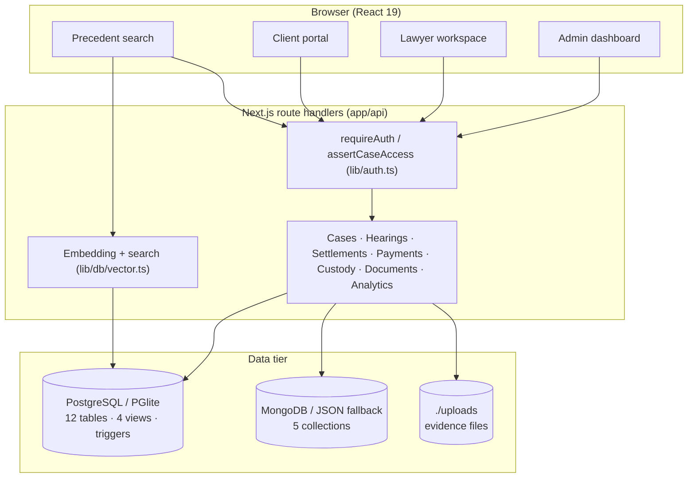
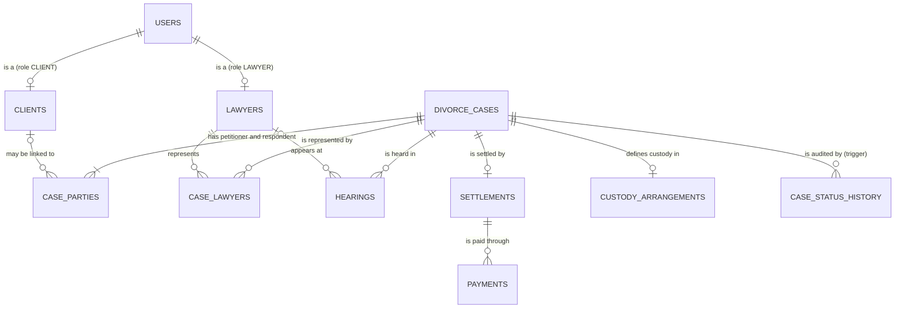

# DIVORCE MANAGEMENT SYSTEM (DMS)
## DBMS Mini-Project Report

| | |
|---|---|
| **Course** | Database Management Systems (DBMS) Mini-Project |
| **Institution** | PES University, Bengaluru |
| **Academic Year** | 2026–2027 |
| **Team** | Sudeeksh Nayak (PES1UG24CS474): design & implementation<br>Subramani B M (PES1UG24CS473): verification, fixes & documentation |
| **Semester / Section** | 5 / H |

---

## 1. Title Page & Project Information
- **Project title**: Divorce Management System (DMS)
- **Domain**: Legal tech, family-court matrimonial case management
- **Architecture**: Polyglot persistence. The core is a PostgreSQL relational database in 3NF. MongoDB serves as the document store, and 16-dimensional vector search runs inside PostgreSQL.
- **Application stack**: Next.js 16 (App Router), React 19, TypeScript, Tailwind CSS 4
- **Data access**: Hand-written parameterised SQL through a thin client (`lib/db/postgres.ts`) that targets either a PostgreSQL server (`pg` pool) or the embedded PGlite engine. `prisma/schema.prisma` documents the same model as schema-as-code.

---

## 2. Abstract
The Divorce Management System (DMS) is a case-management platform for family courts, advocates and litigants. It tracks a divorce matter end to end: registering the petition, linking both parties and their counsel, scheduling hearings, recording settlements and the payments made against them, child-custody terms, evidence documents, messages and counsel notes.

The project is database-centric. All structured, integrity-critical data lives in a **PostgreSQL schema of 12 tables in Third Normal Form**, protected by primary keys, foreign keys with explicit `CASCADE` / `RESTRICT` / `SET NULL` rules, 25 `CHECK` constraints and 2 composite `UNIQUE` constraints. The database itself enforces business rules:

- a **trigger** writes an audit row, including the acting user and the reason, for every case status change
- a **PL/pgSQL function** issues docket numbers
- **four views** provide reporting
- **composite indexes** support the hot query paths, such as advocate conflict detection

Multi-step operations run as **ACID transactions**. Semi-structured, append-heavy data (activity timelines, documents, communications, notes, audit logs) lives in **MongoDB** and is analysed with a `$facet` aggregation pipeline. A **16-dimensional vector search** ranks legal precedents by cosine similarity, computed inside PostgreSQL.

Correctness is demonstrated by **16 demonstration queries** and an **11-test SQL verification suite**, all of which run against a real PostgreSQL 16 server.

---

## 3. Problem Statement & Motivation
Family-court matters involve two opposing parties, often two sets of counsel, multiple hearings, money that is paid in instalments, and children whose custody must be recorded. Common problems are:

1. **No link between money and orders**: payments are tracked separately from the settlement they belong to, so balances drift.
2. **Advocate double-booking**: the same advocate gets listed in two courtrooms at overlapping times.
3. **Weak audit trail**: case stages change without a reliable record of who changed them and why.
4. **Opaque status for litigants**: parties cannot see where their own case stands.
5. **Hard precedent lookup**: keyword search misses conceptually related judgments.

DMS addresses each of these at the database level:

- foreign keys and a ledger view tie money to orders
- an indexed range query detects scheduling conflicts
- a trigger keeps the audit trail
- role-scoped queries give each litigant a view of their own case
- vector search finds related precedents

---

## 4. Objectives & Scope
### Objectives
- Design a 3NF relational schema for the full lifecycle of a divorce case.
- Enforce integrity declaratively with PK, FK (with referential actions), UNIQUE and CHECK constraints.
- Automate auditing with a trigger, and docket numbering with a stored function.
- Run multi-step operations (case registration, payments, onboarding, status updates) as ACID transactions.
- Detect advocate scheduling conflicts within a 45-minute window using an index-supported query.
- Provide 4 reporting views and 16 demonstration queries that cover the DBMS syllabus.
- Store semi-structured case data in MongoDB and analyse it with a `$facet` pipeline.
- Rank legal resources by cosine similarity over 16-D embeddings.

### Scope
- **Case lifecycle**: registration → review → documentation → mediation → hearings → settlement negotiation → final order → resolved/closed.
- **Role-based workspaces** for Admin, Lawyer and Client, enforced on the server.
- **Financial ledger**: settlement terms, instalment payments, automatically computed balance and status.
- **Child custody**: custody type, number of children, visitation, monthly support.
- **Out of scope**: e-filing integration with real court systems, payment gateways, and real legal advice.

---

## 5. Technology Stack & Justification

| Layer | Technology | Why |
|---|---|---|
| Relational database | PostgreSQL 16 (server) or PGlite (embedded PostgreSQL in WebAssembly) | Full SQL: constraints, triggers, PL/pgSQL, views, window functions, ACID. PGlite lets the project run with zero database setup. |
| Document database | MongoDB (official Node.js driver) with a JSON-file fallback | Flexible schemas for timelines, documents and messages, plus aggregation pipelines. |
| Vector search | `FLOAT8[]` embeddings + PL/pgSQL `fn_cosine_similarity()` | Same metric as pgvector's `<=>`, without needing an extension. |
| Application | Next.js 16 App Router, React 19, TypeScript | One codebase for the UI and the REST API route handlers. |
| Styling | Tailwind CSS 4 (via `@tailwindcss/postcss`) | Utility-first styling. |
| Auth | `bcryptjs` (cost 10) + JWT (`jose`, HS256) in an HTTP-only cookie | Salted password hashing; stateless sessions. |
| Validation | Zod | Every API payload is validated before it reaches SQL. |

---

## 6. System Architecture



**Request flow, using case registration as the example.** The browser POSTs to `/api/cases`. `requireAuth` verifies the JWT cookie. Zod validates the body. One PostgreSQL transaction then writes the case, both parties, counsel and the first history row. After the commit, an activity event is appended to MongoDB.

---

## 7. Entity-Relationship Model


`LEGAL_RESOURCES` is a standalone reference table, the corpus for vector search.

**Key modelling decisions**
- **Specialisation (ISA)**: `users` holds login identity. `lawyers` and `clients` extend it 1:1 through a `UNIQUE` foreign key `user_id`.
- **M:N resolved with associative entities**: a case has many lawyers and a lawyer has many cases, so `case_lawyers` (with `representing_role`, `is_lead_counsel`, `is_active`) resolves the relationship. In the same way, `case_parties` links a case to exactly one petitioner and one respondent, enforced by `UNIQUE (case_id, party_role)`.
- **1:1 relationships** (`settlements`, `custody_arrangements` to `divorce_cases`) are enforced with `UNIQUE (case_id)`.
- **Weak dependency**: `payments` cannot exist without a `settlements` row (`NOT NULL` FK, `ON DELETE CASCADE`).

---

## 8. Relational Schema & Normalisation (3NF)

**Relational schema** (PK underlined in prose as `id`; FK → referenced table):
- users(**id**, email, password_hash, role, full_name, phone_number, is_active, created_at, updated_at)
- lawyers(**id**, user_id → users, bar_registration_number, specialization, years_experience, office_address, hourly_rate, max_case_capacity, …)
- clients(**id**, user_id → users, national_id, address, occupation, annual_income, …)
- divorce_cases(**id**, reference_number, case_title, divorce_category, filing_date, marriage_date, marriage_place, separation_date, status, priority, presiding_court, resolution_date, notes, …)
- case_parties(**id**, case_id → divorce_cases, client_id → clients, party_role, full_name, gender, date_of_birth, email, phone_number, current_address, employment, monthly_income, …)
- case_lawyers(**id**, case_id → divorce_cases, lawyer_id → lawyers, representing_role, assigned_at, is_lead_counsel, is_active)
- hearings(**id**, case_id → divorce_cases, assigned_lawyer_id → lawyers, hearing_date, court_room, judge_name, hearing_type, outcome, summary_notes, next_hearing_date, …)
- settlements(**id**, case_id → divorce_cases, settlement_type, total_agreed_amount, monthly_alimony, alimony_tenure_months, payment_status, terms_conditions, settlement_date, …)
- payments(**id**, settlement_id → settlements, amount_paid, payment_date, payment_method, transaction_reference, receipt_notes, …)
- custody_arrangements(**id**, case_id → divorce_cases, custody_type, number_of_children, children_details, visitation_schedule, monthly_support_amount, special_conditions, is_agreed, …)
- case_status_history(**id**, case_id → divorce_cases, previous_status, new_status, changed_by_user_id, reason, changed_at)
- legal_resources(**id**, title, category, citation, content, summary, tags, embedding)

**1NF.** Every column holds one atomic value. Each party is a separate row in `case_parties`, not columns like `petitioner_name` and `respondent_name`. Each payment is a separate row, not a list. The exceptions are `legal_resources.tags` and `.embedding`. These are PostgreSQL arrays used as single opaque values: the embedding is always read as a whole vector and never queried element by element through joins. They sit in a reference table outside the transactional core.

**2NF.** Every table has a single-column surrogate key `id`, so no partial dependencies on part of a composite key can exist. The natural composite candidate keys, `(case_id, party_role)` in `case_parties` and `(case_id, lawyer_id, representing_role)` in `case_lawyers`, are declared as `UNIQUE`. Every non-key attribute depends on the whole of these keys.

**3NF.** No non-key attribute depends on another non-key attribute:
- Lawyer attributes (bar number, rate, capacity) live in `lawyers`, not in `case_lawyers` or `hearings`.
- Login identity (email, name, phone) lives once in `users`. `lawyers` and `clients` refer to it by `user_id` instead of copying it.
- Case-level facts (court, dates, status) live in `divorce_cases`. Hearings refer to the case and do not repeat them.
- Derived values are **not stored**: amount paid and outstanding balance are computed from `payments` in the view `v_financial_settlement_ledger`, so they can never fall out of sync with the payments.

**Design note on `case_parties`.** A party's name and contact details are stored on the party row because many litigants (for example, the respondent) never create an account (`client_id` is `NULL`). The row also records the party's particulars as filed. Within `case_parties`, every attribute depends only on the party row's key, so the relation is in 3NF. The optional `client_id` links the filed party to a portal account when one exists.

---

## 9. Data Dictionary
Generated directly from the live database catalog (`information_schema`) after running `sql/schema.sql`, so it matches the DDL exactly.

### 9.1 `users`
Login identity and role for every person using the system.

| Column | Type | Keys / constraints / default |
|---|---|---|
| `id` | VARCHAR(36) | PK |
| `email` | VARCHAR(255) | UNIQUE, NOT NULL |
| `password_hash` | VARCHAR(255) | NOT NULL |
| `role` | VARCHAR(20) | NOT NULL, DEFAULT 'CLIENT' |
| `full_name` | VARCHAR(150) | NOT NULL |
| `phone_number` | VARCHAR(25) |  |
| `is_active` | BOOLEAN | NOT NULL, DEFAULT true |
| `created_at` | TIMESTAMPTZ | DEFAULT CURRENT_TIMESTAMP |
| `updated_at` | TIMESTAMPTZ | DEFAULT CURRENT_TIMESTAMP |

### 9.2 `lawyers`
Advocate profile; 1:1 extension of a LAWYER user.

| Column | Type | Keys / constraints / default |
|---|---|---|
| `id` | VARCHAR(36) | PK |
| `user_id` | VARCHAR(36) | FK → users(id) ON DELETE CASCADE, UNIQUE, NOT NULL |
| `bar_registration_number` | VARCHAR(50) | UNIQUE, NOT NULL |
| `specialization` | VARCHAR(100) | NOT NULL, DEFAULT 'Family Law' |
| `years_experience` | INTEGER | NOT NULL, DEFAULT 1 |
| `office_address` | TEXT |  |
| `hourly_rate` | NUMERIC(10,2) | DEFAULT 1500.00 |
| `max_case_capacity` | INTEGER | NOT NULL, DEFAULT 15 |
| `created_at` | TIMESTAMPTZ | DEFAULT CURRENT_TIMESTAMP |
| `updated_at` | TIMESTAMPTZ | DEFAULT CURRENT_TIMESTAMP |

### 9.3 `clients`
Litigant profile; 1:1 extension of a CLIENT user.

| Column | Type | Keys / constraints / default |
|---|---|---|
| `id` | VARCHAR(36) | PK |
| `user_id` | VARCHAR(36) | FK → users(id) ON DELETE CASCADE, UNIQUE, NOT NULL |
| `national_id` | VARCHAR(50) | UNIQUE |
| `address` | TEXT |  |
| `occupation` | VARCHAR(100) |  |
| `annual_income` | NUMERIC(12,2) | DEFAULT 0.00 |
| `created_at` | TIMESTAMPTZ | DEFAULT CURRENT_TIMESTAMP |
| `updated_at` | TIMESTAMPTZ | DEFAULT CURRENT_TIMESTAMP |

### 9.4 `divorce_cases`
One row per matrimonial case.

| Column | Type | Keys / constraints / default |
|---|---|---|
| `id` | VARCHAR(36) | PK |
| `reference_number` | VARCHAR(30) | UNIQUE, NOT NULL |
| `case_title` | VARCHAR(255) | NOT NULL |
| `divorce_category` | VARCHAR(100) | NOT NULL, DEFAULT 'Mutual Consent' |
| `filing_date` | DATE | NOT NULL, DEFAULT CURRENT_DATE |
| `marriage_date` | DATE | NOT NULL |
| `marriage_place` | VARCHAR(150) |  |
| `separation_date` | DATE |  |
| `status` | VARCHAR(30) | NOT NULL, DEFAULT 'REGISTERED' |
| `priority` | VARCHAR(15) | NOT NULL, DEFAULT 'MEDIUM' |
| `presiding_court` | VARCHAR(150) | NOT NULL, DEFAULT 'Family Court Division 1' |
| `resolution_date` | DATE |  |
| `notes` | TEXT |  |
| `created_at` | TIMESTAMPTZ | DEFAULT CURRENT_TIMESTAMP |
| `updated_at` | TIMESTAMPTZ | DEFAULT CURRENT_TIMESTAMP |

### 9.5 `case_parties`
Petitioner and respondent of each case (exactly one of each per case).

| Column | Type | Keys / constraints / default |
|---|---|---|
| `id` | VARCHAR(36) | PK |
| `case_id` | VARCHAR(36) | FK → divorce_cases(id) ON DELETE CASCADE, UNIQUE (composite), NOT NULL |
| `client_id` | VARCHAR(36) | FK → clients(id) ON DELETE SET NULL |
| `party_role` | VARCHAR(15) | UNIQUE (composite), NOT NULL |
| `full_name` | VARCHAR(150) | NOT NULL |
| `gender` | VARCHAR(10) | DEFAULT 'OTHER' |
| `date_of_birth` | DATE |  |
| `email` | VARCHAR(255) |  |
| `phone_number` | VARCHAR(25) |  |
| `current_address` | TEXT |  |
| `employment` | VARCHAR(100) |  |
| `monthly_income` | NUMERIC(10,2) | DEFAULT 0.00 |
| `created_at` | TIMESTAMPTZ | DEFAULT CURRENT_TIMESTAMP |

### 9.6 `case_lawyers`
Associative entity resolving the M:N between cases and lawyers.

| Column | Type | Keys / constraints / default |
|---|---|---|
| `id` | VARCHAR(36) | PK |
| `case_id` | VARCHAR(36) | FK → divorce_cases(id) ON DELETE CASCADE, UNIQUE (composite), NOT NULL |
| `lawyer_id` | VARCHAR(36) | FK → lawyers(id) ON DELETE RESTRICT, UNIQUE (composite), NOT NULL |
| `representing_role` | VARCHAR(15) | UNIQUE (composite), NOT NULL, DEFAULT 'PETITIONER' |
| `assigned_at` | TIMESTAMPTZ | DEFAULT CURRENT_TIMESTAMP |
| `is_lead_counsel` | BOOLEAN | NOT NULL, DEFAULT true |
| `is_active` | BOOLEAN | NOT NULL, DEFAULT true |

### 9.7 `hearings`
Court sittings of a case and the appearing advocate.

| Column | Type | Keys / constraints / default |
|---|---|---|
| `id` | VARCHAR(36) | PK |
| `case_id` | VARCHAR(36) | FK → divorce_cases(id) ON DELETE CASCADE, NOT NULL |
| `assigned_lawyer_id` | VARCHAR(36) | FK → lawyers(id) ON DELETE SET NULL |
| `hearing_date` | TIMESTAMPTZ | NOT NULL |
| `court_room` | VARCHAR(50) | NOT NULL, DEFAULT 'Court Hall 3' |
| `judge_name` | VARCHAR(100) | NOT NULL, DEFAULT 'Hon. Justice M. Rao' |
| `hearing_type` | VARCHAR(30) | NOT NULL, DEFAULT 'PRELIMINARY' |
| `outcome` | VARCHAR(30) | NOT NULL, DEFAULT 'SCHEDULED' |
| `summary_notes` | TEXT |  |
| `next_hearing_date` | TIMESTAMPTZ |  |
| `created_at` | TIMESTAMPTZ | DEFAULT CURRENT_TIMESTAMP |
| `updated_at` | TIMESTAMPTZ | DEFAULT CURRENT_TIMESTAMP |

### 9.8 `settlements`
Financial terms of a case (at most one per case).

| Column | Type | Keys / constraints / default |
|---|---|---|
| `id` | VARCHAR(36) | PK |
| `case_id` | VARCHAR(36) | FK → divorce_cases(id) ON DELETE CASCADE, UNIQUE, NOT NULL |
| `settlement_type` | VARCHAR(30) | NOT NULL, DEFAULT 'LUMP_SUM' |
| `total_agreed_amount` | NUMERIC(12,2) | NOT NULL, DEFAULT 0.00 |
| `monthly_alimony` | NUMERIC(10,2) | NOT NULL, DEFAULT 0.00 |
| `alimony_tenure_months` | INTEGER | NOT NULL, DEFAULT 0 |
| `payment_status` | VARCHAR(20) | NOT NULL, DEFAULT 'PENDING' |
| `terms_conditions` | TEXT |  |
| `settlement_date` | DATE |  |
| `created_at` | TIMESTAMPTZ | DEFAULT CURRENT_TIMESTAMP |
| `updated_at` | TIMESTAMPTZ | DEFAULT CURRENT_TIMESTAMP |

### 9.9 `payments`
Instalments paid against a settlement.

| Column | Type | Keys / constraints / default |
|---|---|---|
| `id` | VARCHAR(36) | PK |
| `settlement_id` | VARCHAR(36) | FK → settlements(id) ON DELETE CASCADE, NOT NULL |
| `amount_paid` | NUMERIC(10,2) | NOT NULL |
| `payment_date` | TIMESTAMPTZ | DEFAULT CURRENT_TIMESTAMP |
| `payment_method` | VARCHAR(50) | NOT NULL, DEFAULT 'Bank Transfer' |
| `transaction_reference` | VARCHAR(100) | UNIQUE, NOT NULL |
| `receipt_notes` | TEXT |  |
| `created_at` | TIMESTAMPTZ | DEFAULT CURRENT_TIMESTAMP |

### 9.10 `custody_arrangements`
Child-custody terms of a case (at most one per case).

| Column | Type | Keys / constraints / default |
|---|---|---|
| `id` | VARCHAR(36) | PK |
| `case_id` | VARCHAR(36) | FK → divorce_cases(id) ON DELETE CASCADE, UNIQUE, NOT NULL |
| `custody_type` | VARCHAR(30) | NOT NULL, DEFAULT 'JOINT_LEGAL' |
| `number_of_children` | INTEGER | NOT NULL, DEFAULT 1 |
| `children_details` | TEXT |  |
| `visitation_schedule` | TEXT |  |
| `monthly_support_amount` | NUMERIC(10,2) | DEFAULT 0.00 |
| `special_conditions` | TEXT |  |
| `is_agreed` | BOOLEAN | NOT NULL, DEFAULT false |
| `created_at` | TIMESTAMPTZ | DEFAULT CURRENT_TIMESTAMP |
| `updated_at` | TIMESTAMPTZ | DEFAULT CURRENT_TIMESTAMP |

### 9.11 `case_status_history`
Audit trail populated by trg_case_status_audit (and the first row at registration).

| Column | Type | Keys / constraints / default |
|---|---|---|
| `id` | VARCHAR(36) | PK |
| `case_id` | VARCHAR(36) | FK → divorce_cases(id) ON DELETE CASCADE, NOT NULL |
| `previous_status` | VARCHAR(30) |  |
| `new_status` | VARCHAR(30) | NOT NULL |
| `changed_by_user_id` | VARCHAR(36) |  |
| `reason` | TEXT |  |
| `changed_at` | TIMESTAMPTZ | DEFAULT CURRENT_TIMESTAMP |

### 9.12 `legal_resources`
Corpus of statutes, precedents and templates for vector search.

| Column | Type | Keys / constraints / default |
|---|---|---|
| `id` | VARCHAR(36) | PK |
| `title` | VARCHAR(255) | NOT NULL |
| `category` | VARCHAR(50) | NOT NULL, DEFAULT 'STATUTE' |
| `citation` | VARCHAR(100) |  |
| `content` | TEXT | NOT NULL |
| `summary` | TEXT |  |
| `tags` | TEXT[] |  |
| `embedding` | FLOAT8[] |  |
| `created_at` | TIMESTAMPTZ | DEFAULT CURRENT_TIMESTAMP |
| `updated_at` | TIMESTAMPTZ | DEFAULT CURRENT_TIMESTAMP |


### CHECK constraints (25)
- `case_lawyers.chk_caselawyer_role`: `CHECK ((representing_role) IN ('PETITIONER', 'RESPONDENT'))`
- `case_parties.chk_party_gender`: `CHECK ((gender) IN ('MALE', 'FEMALE', 'OTHER'))`
- `case_parties.chk_party_income`: `CHECK (monthly_income >= (0))`
- `case_parties.chk_party_role`: `CHECK ((party_role) IN ('PETITIONER', 'RESPONDENT'))`
- `clients.chk_client_income`: `CHECK (annual_income >= (0))`
- `custody_arrangements.chk_children_count`: `CHECK (number_of_children >= 1)`
- `custody_arrangements.chk_custody_type`: `CHECK ((custody_type) IN ('SOLE_PETITIONER', 'SOLE_RESPONDENT', 'JOINT_LEGAL', 'SHARED_PHYSICAL', 'THIRD_PARTY_GUARDIAN'))`
- `custody_arrangements.chk_support_amount`: `CHECK (monthly_support_amount >= (0))`
- `divorce_cases.chk_case_priority`: `CHECK ((priority) IN ('LOW', 'MEDIUM', 'HIGH', 'URGENT'))`
- `divorce_cases.chk_case_status`: `CHECK ((status) IN ('REGISTERED', 'UNDER_REVIEW', 'DOCUMENTATION_PENDING', 'MEDIATION', 'HEARING_SCHEDULED', 'SETTLEMENT_NEGOTIATION', 'AWAITING_FINAL_ORDER', 'RESOLVED', 'CLOSED'))`
- `divorce_cases.chk_marriage_dates`: `CHECK (marriage_date <= filing_date)`
- `divorce_cases.chk_resolution_date`: `CHECK ((resolution_date IS NULL) OR (resolution_date >= filing_date))`
- `divorce_cases.chk_separation_date`: `CHECK ((separation_date IS NULL) OR (separation_date >= marriage_date))`
- `hearings.chk_hearing_outcome`: `CHECK ((outcome) IN ('SCHEDULED', 'ADJOURNED', 'SETTLEMENT_REACHED', 'ORDER_PASSED', 'DISMISSED', 'CONCLUDED'))`
- `hearings.chk_hearing_type`: `CHECK ((hearing_type) IN ('PRELIMINARY', 'MEDIATION_SESSION', 'EVIDENCE_PRESENTATION', 'CROSS_EXAMINATION', 'FINAL_ARGUMENTS', 'JUDGMENT_PRONOUNCEMENT'))`
- `hearings.chk_next_hearing`: `CHECK ((next_hearing_date IS NULL) OR (next_hearing_date > hearing_date))`
- `lawyers.chk_lawyer_capacity`: `CHECK ((max_case_capacity >= 1) AND (max_case_capacity <= 50))`
- `lawyers.chk_lawyer_exp`: `CHECK (years_experience >= 0)`
- `lawyers.chk_lawyer_rate`: `CHECK (hourly_rate >= (0))`
- `payments.chk_payment_amount`: `CHECK (amount_paid > (0))`
- `settlements.chk_settlement_amounts`: `CHECK ((total_agreed_amount >= (0) AND (monthly_alimony >= (0) AND (alimony_tenure_months >= 0))`
- `settlements.chk_settlement_status`: `CHECK ((payment_status) IN ('PENDING', 'PARTIALLY_PAID', 'COMPLETED', 'DEFAULTED'))`
- `settlements.chk_settlement_type`: `CHECK ((settlement_type) IN ('LUMP_SUM', 'MONTHLY_ALIMONY', 'CHILD_SUPPORT', 'PROPERTY_DIVISION', 'HYBRID'))`
- `users.chk_user_email_format`: `CHECK ((email) ~* '^[A-Za-z0-9._%+-]+@[A-Za-z0-9.-]+\.[A-Za-z]{2,}$')`
- `users.chk_user_role`: `CHECK ((role) IN ('ADMIN', 'LAWYER', 'CLIENT'))`

---

## 10. MongoDB Document Model
MongoDB holds data that is append-heavy, varies in shape, and does not take part in relational integrity rules. Collections and indexes are created by `lib/db/mongodb.ts`.

| Collection | Purpose | Index |
|---|---|---|
| `case_activities` | Timeline events (registered, hearing scheduled, status changed, payment recorded, …) | `{caseId:1, timestamp:-1}`, `{eventType:1}` |
| `case_documents` | Metadata and storage path for uploaded evidence; per-document `allowedRoles` | `{caseId:1, category:1}` |
| `case_communications` | Messages between parties, counsel and registry | `{caseId:1, createdAt:1}` |
| `case_notes` | Counsel notes; `isPrivateToCounsel` hides them from clients | `{caseId:1, lawyerId:1}` |
| `audit_logs` | Login success/failure and other security events | `{timestamp:-1}` |

Example `case_activities` document:
```json
{
  "caseId": "cas-001",
  "referenceNumber": "DIV-2026-0001",
  "eventType": "STATUS_CHANGED",
  "title": "Status Changed to SETTLEMENT NEGOTIATION",
  "description": "Case status updated from MEDIATION to SETTLEMENT_NEGOTIATION.",
  "actorId": "usr-law-001",
  "actorName": "Adv. Vikram Mehta",
  "actorRole": "LAWYER",
  "metadata": { "previousStatus": "MEDIATION", "newStatus": "SETTLEMENT_NEGOTIATION" },
  "timestamp": "2026-11-01T10:30:00.000Z"
}
```

**Availability.** If MongoDB cannot be reached, the same API reads and writes JSON files in `./data/mongodb_fallback`, which are seeded with the same initial data. After a failed connection, the app waits 30 seconds before retrying, so that requests do not each wait out the driver timeout. The analytics pipeline has an equivalent in-memory implementation for this mode.

---

## 11. Vector Semantic Search
**Embedding.** `generateLegalEmbedding()` in `lib/db/vector.ts` maps any text onto 16 legal concepts (`lib/constants/vector.ts`): mutual consent, contested grounds, alimony/maintenance, child custody, asset division, cooling-off waiver, Hindu Marriage Act, Special Marriage Act, mediation, evidence/procedure, jurisdiction, cruelty/desertion, visitation, financial disclosure, settlement agreement, and Supreme Court precedent. Each dimension is scored by matching weighted keywords. The vector is then L2-normalised to unit length.

The stored embedding for each `legal_resources` row is produced by the **same function** from that row's title, summary, tags and content. This keeps query vectors and document vectors in the same space.

**Similarity.** Ranking happens in SQL:
```sql
SELECT id, title, fn_cosine_similarity(embedding, $1::float8[]) AS similarity_score
FROM legal_resources
[WHERE category = $2]
ORDER BY similarity_score DESC
LIMIT $n;
```
where

$$\cos(\vec q,\vec r)=\frac{\sum_{i=1}^{16} q_i r_i}{\sqrt{\sum q_i^2}\,\sqrt{\sum r_i^2}}$$

**Verified results** (seed corpus of 5 resources):

| Query | Top result | Score |
|---|---|---|
| "waiver of 6 months waiting period" | Mutual Consent Divorce Procedure, HMA s.13B | 0.500 |
| "interim maintenance alimony affidavit of assets" | Rajnesh v. Neha alimony guidelines | 0.684 |
| "child custody visitation weekend" | Welfare of the Child principle | 0.868 |
| "streedhan jewellery property partition" | Settlement Agreement Template | 0.622 |
| "civil court marriage under special marriage act" | Special Marriage Act s.28 | 0.924 |

*Design choice:* the extension-free function was chosen over pgvector so the project runs on the embedded engine with no installation. On a server with pgvector, the column could become `vector(16)` and the query could use `ORDER BY embedding <=> $1` with an HNSW/IVFFlat index.

---

## 12. Functions & Triggers

### 12.1 `fn_generate_case_reference()`: docket number generator
```sql
CREATE OR REPLACE FUNCTION fn_generate_case_reference()
RETURNS VARCHAR AS $$
DECLARE
    v_year TEXT := TO_CHAR(CURRENT_DATE, 'YYYY');
    v_count INT;
    v_new_ref VARCHAR;
BEGIN
    SELECT COALESCE(MAX(CAST(SUBSTRING(reference_number FROM '^DIV-[0-9]{4}-([0-9]+)$') AS INT)), 0) + 1
    INTO v_count
    FROM divorce_cases
    WHERE reference_number LIKE 'DIV-' || v_year || '-%';
    v_new_ref := 'DIV-' || v_year || '-' || LPAD(v_count::TEXT, 4, '0');
    RETURN v_new_ref;
END;
$$ LANGUAGE plpgsql;
```
The function is called inside the case-registration transaction and produces numbers such as `DIV-2026-0007`. Using `MAX(suffix) + 1` instead of `COUNT(*) + 1` means deleting a case never re-issues an existing number (test TC-DB-08).

### 12.2 `fn_cosine_similarity(a FLOAT8[], b FLOAT8[])`
This is an `IMMUTABLE` PL/pgSQL function. It returns the dot product divided by the product of the L2 norms, and returns 0 for empty or zero vectors (test TC-DB-11).

### 12.3 `trg_case_status_audit`: status audit trigger
```sql
CREATE OR REPLACE FUNCTION fn_trg_case_status_audit()
RETURNS TRIGGER AS $$
BEGIN
    IF (OLD.status IS DISTINCT FROM NEW.status) THEN
        INSERT INTO case_status_history (id, case_id, previous_status, new_status,
                                         changed_by_user_id, reason, changed_at)
        VALUES (
            'hist-' || substr(md5(random()::text || clock_timestamp()::text), 1, 16),
            NEW.id, OLD.status, NEW.status,
            COALESCE(NULLIF(current_setting('dms.current_user_id', true), ''), 'SYSTEM_AUTO'),
            COALESCE(NULLIF(current_setting('dms.status_reason', true), ''),
                     'Automated trigger status transition recorded from ' || OLD.status || ' to ' || NEW.status),
            CURRENT_TIMESTAMP);
    END IF;
    RETURN NEW;
END;
$$ LANGUAGE plpgsql;

CREATE TRIGGER trg_case_status_audit
AFTER UPDATE OF status ON divorce_cases
FOR EACH ROW EXECUTE FUNCTION fn_trg_case_status_audit();
```
The application performs the status update inside a transaction that first runs `set_config('dms.current_user_id', <user>, true)` and `set_config('dms.status_reason', <reason>, true)`. The third argument, `true`, makes these settings **transaction-local**, so the trigger records exactly who made the change and why, and the values cannot leak into other requests. A status changed directly in SQL is still audited, with `SYSTEM_AUTO` as the actor.

### 12.4 `trg_users_timestamp`, `trg_cases_timestamp`, `trg_settlements_timestamp`
These `BEFORE UPDATE` row triggers run `fn_trg_update_timestamp()`, which sets `updated_at = CURRENT_TIMESTAMP`.

---

## 13. Views
| View | What it returns | Used by |
|---|---|---|
| `v_active_cases_overview` | One row per open case (not RESOLVED/CLOSED): parties, lead counsel (petitioner's counsel first, chosen with a `LATERAL … LIMIT 1` subquery), hearing count | Reporting / viva demo |
| `v_upcoming_hearings_summary` | Scheduled hearings with the case and the advocate's name and phone | Reporting / viva demo |
| `v_lawyer_workload_metrics` | Per lawyer: open-case count (`COUNT(DISTINCT …) FILTER (WHERE …)`), capacity utilisation %, pending hearings | `/api/lawyers`, `/api/analytics` |
| `v_financial_settlement_ledger` | Per settlement: total paid, outstanding balance, number of transactions, latest payment | `/api/analytics`, settlements page |

`v_active_cases_overview` uses a `LATERAL` subquery to pick a single lead counsel. A plain join would return one row per lead counsel, which duplicates every case that has counsel on both sides and double-counts its hearings. Test TC-DB-09 checks for this.

---

## 14. Indexes & Query Optimisation
Primary keys and `UNIQUE` constraints create their own B-tree indexes (for example, `reference_number`, `transaction_reference`, `bar_registration_number`). The following indexes are added explicitly:

| Index | Columns | Serves |
|---|---|---|
| `idx_cases_status_priority` | `divorce_cases(status, priority)` | Registry/dashboard filters (leading column also serves status-only filters) |
| `idx_hearings_lawyer_date` | `hearings(assigned_lawyer_id, hearing_date)` | Advocate conflict detection (equality + range) |
| `idx_payments_settlement_date` | `payments(settlement_id, payment_date)` | Ledger aggregation, running totals |
| `idx_cases_filing_date`, `idx_cases_priority` | single column | Date-range and priority reports |
| `idx_hearings_date`, `idx_hearings_case_id` | single column | Docket by date / by case |
| `idx_case_lawyers_lawyer`, `idx_case_parties_case`, `idx_case_parties_client` | FK columns | Joins and role scoping |
| `idx_status_history_case`, `idx_legal_resources_category` | FK / filter column | Audit history, category filter |

Single-column indexes that would duplicate the leading column of a composite or UNIQUE index were removed. **Evidence** that the conflict check uses the composite index for both predicates (`EXPLAIN`, with sequential scans disabled to simulate a large table):
```
Index Scan using idx_hearings_lawyer_date on hearings h
  Index Cond: ((assigned_lawyer_id = 'law-001') AND (hearing_date > (now() - '00:45:00'))
               AND (hearing_date < (now() + '00:45:00')))
```

---

## 15. The 16 Demonstration Queries (`sql/demonstration_queries.sql`)
Each query was run against the seed data. *Rows* is the number of rows it returns.

| # | Concept | What it answers | Rows |
|---|---|---|---|
| 1 | INNER JOIN (4 tables) | Active counsel assignments per case | 7 |
| 2 | LEFT OUTER JOIN + COUNT/CASE | Each lawyer's caseload vs capacity (includes lawyers with no cases) | 3 |
| 3 | Multi-table join (6 relations; `case_parties` joined twice under two aliases) | Scheduled hearings with petitioner, respondent and counsel | 3 |
| 4 | GROUP BY + HAVING + STRING_AGG | Lawyers with ≥ 2 open HIGH/URGENT cases | 2 |
| 5 | Aggregates SUM/AVG/MIN/MAX/COUNT | Settlement statistics by settlement type | 2 |
| 6 | Nested subquery with IN | Cases that have had an adjourned hearing | 1 |
| 7 | Correlated subquery | Cases pending longer than the average for their category | 2 |
| 8 | EXISTS | Cases with a custody arrangement | 2 |
| 9 | NOT EXISTS | Open cases with no settlement yet | 3 |
| 10 | Searched CASE expression | Administrative escalation flag per case | 6 |
| 11 | Date/interval arithmetic, TO_CHAR, DATE_PART | Hearings in the next 14 days | 2 |
| 12 | Window: ROW_NUMBER, DENSE_RANK … PARTITION BY | Lawyer seniority and rate rank within specialisation | 3 |
| 13 | Window: SUM() OVER (running total) | Cumulative payments collected | 3 |
| 14 | UNION | Combined contact directory of advocates and litigants | 15 |
| 15 | Scalar subquery (AVG) as threshold | Custody arrangements with above-average monthly support | 1 |
| 16 | Window: LAG() over the trigger-populated audit table | Days between consecutive status changes per case | 7 |

---

## 16. MongoDB Aggregation Pipeline (`$facet`)
`getActivityAnalyticsPipeline()` in `lib/db/mongodb.ts` runs one pass over `case_activities` that produces three independent result sets:
```javascript
db.case_activities.aggregate([
  { $facet: {
      monthlyTrends: [
        { $group: { _id: { $dateToString: { format: '%Y-%m', date: '$timestamp' } },
                    eventCount: { $sum: 1 }, casesSet: { $addToSet: '$caseId' } } },
        { $project: { _id: 0, month: '$_id', eventCount: 1, uniqueCases: { $size: '$casesSet' } } },
        { $sort: { month: 1 } } ],
      eventDistribution: [
        { $group: { _id: '$eventType', count: { $sum: 1 } } },
        { $project: { _id: 0, eventType: '$_id', count: 1 } },
        { $sort: { count: -1 } } ],
      actorVelocity: [
        { $group: { _id: { actorName: '$actorName', actorRole: '$actorRole' }, actionsCount: { $sum: 1 } } },
        { $project: { _id: 0, actorName: '$_id.actorName', actorRole: '$_id.actorRole', actionsCount: 1 } },
        { $sort: { actionsCount: -1 } }, { $limit: 6 } ]
  } }
]);
```
`/api/analytics` combines this pipeline with SQL aggregates (status and category distribution, monthly registrations with `DATE_TRUNC`, resolution latency) and the two reporting views. Together these feed the analytics dashboard.

---

## 17. Advocate Conflict Detection
Before a hearing is inserted, `POST /api/hearings` runs:
```sql
SELECT h.id, h.hearing_date, h.court_room, c.reference_number, c.case_title, u.full_name AS lawyer_name
FROM hearings h
JOIN divorce_cases c ON h.case_id = c.id
JOIN lawyers l ON h.assigned_lawyer_id = l.id
JOIN users u ON l.user_id = u.id
WHERE h.assigned_lawyer_id = $1
  AND h.outcome = 'SCHEDULED'
  AND h.hearing_date > ($2::timestamptz - INTERVAL '45 minutes')
  AND h.hearing_date < ($2::timestamptz + INTERVAL '45 minutes')
LIMIT 1;
```
If a row comes back, the API responds with **HTTP 409 Conflict** and includes the clashing case, time and courtroom. The predicate is written as a range on the raw column, not as `ABS(EXTRACT(EPOCH …))`, so the composite index `idx_hearings_lawyer_date` can be used (Section 14). Test TC-DB-07 checks the boundaries: a booking 30 minutes away is rejected, and one 60 minutes away is accepted.

---

## 18. Transactions & Concurrency
`lib/db/postgres.ts` exposes `db.transaction(fn)`. On a PostgreSQL server it checks out one pooled connection and runs `BEGIN` … `COMMIT`, with `ROLLBACK` on any error. On PGlite it uses the engine's native transaction API.

| Transaction | Steps (all-or-nothing) |
|---|---|
| Case registration (`POST /api/cases`) | generate reference → insert case → insert petitioner → insert respondent → assign counsel → insert first history row |
| Payment (`POST /api/payments`) | insert payment → re-aggregate `SUM(amount_paid)` → set settlement `payment_status` to `PARTIALLY_PAID` or `COMPLETED` |
| Status change (`PATCH /api/cases/[id]`) | set transaction-local actor/reason → `UPDATE` (fires audit and timestamp triggers) |
| User onboarding (`/api/auth/register`, `/api/lawyers`) | insert `users` row → insert `clients`/`lawyers` row |

**Concurrency.** `transaction_reference` is `UNIQUE`, so a double-submitted payment fails at the database even if two requests pass the application's pre-check at the same moment. `reference_number` is also `UNIQUE`. If two registrations ever computed the same docket number, one transaction would fail and roll back completely instead of creating a duplicate. Test TC-DB-03 shows that a failure part-way through a unit of work leaves no partial rows.

---

## 19. Role-Based Access Control
Authentication uses a JWT in an HTTP-only cookie (7-day expiry). Passwords are stored as bcrypt hashes with cost 10. Every API route calls `requireAuth([...roles])`, which returns **401** when no one is logged in and **403** when the role is not allowed. Case-level writes call `assertCaseAccess(user, caseId)`.

| Capability | Admin | Lawyer | Client |
|---|---|---|---|
| List / view cases | All | Assigned cases | Cases where they are a party |
| Register a case | ✓ | ✓ (self-assigned) | ✓ (as petitioner) |
| Change case status / priority | ✓ | Assigned cases | – |
| Schedule hearing / record outcome | ✓ | Assigned cases | – (view own) |
| Create / edit settlement, custody terms | ✓ | Assigned cases | – (view own) |
| Record payment | ✓ | Assigned cases | Own case's settlement |
| Upload documents | ✓ | Assigned cases | Own cases |
| Counsel notes | ✓ | Write; read incl. private | Read non-private only |
| Manage users / create lawyers | ✓ | – | – |
| Reset database | ✓ | – | – |
| Precedent search, analytics | ✓ | ✓ | ✓ |

---

## 20. API Reference
| Method & path | Purpose |
|---|---|
| `POST /api/auth/login` · `POST /api/auth/logout` · `GET /api/auth/me` · `POST /api/auth/register` | Session management and client self-registration |
| `GET, POST /api/cases` · `GET, PATCH /api/cases/[id]` | Case registry (role-scoped), transactional creation, dossier, status updates |
| `GET, POST, PATCH /api/hearings` | Docket, scheduling with conflict detection, outcomes |
| `GET, POST /api/settlements` · `POST /api/payments` | Settlement terms, ledger, payments |
| `GET, POST /api/custody` | Custody arrangements |
| `GET, POST /api/documents` · `GET /api/documents/[id]/download` | Evidence upload (PDF/JPEG/PNG/DOC/DOCX/TXT, ≤ 10 MB) and download |
| `GET, POST /api/notes` · `GET, POST /api/communications` | Counsel notes and case messages (MongoDB) |
| `GET, POST /api/lawyers` · `GET, POST, PATCH /api/users` | Directory (workload view) and administration |
| `POST /api/semantic-search` | Vector precedent search |
| `GET /api/analytics` | Combined SQL and MongoDB dashboard data |
| `GET /api/system/health` · `POST /api/system/reset` | Engine status; reseed (Admin) |

---

## 21. User Interface
- **Layout**: a dark navy sidebar whose navigation changes with the user's role, a header showing database status, and light content panels.
- **Screens**: landing page; login/register; role dashboards (Admin, Lawyer, Client); case registry, new-case wizard and case dossier (parties, counsel, hearings, settlement, custody, documents, notes, messages, status timeline); hearings docket; settlements ledger; custody; analytics; precedent search; users; settings (health check and reset).
- **Feedback**: loading states, validation messages from the API, and a clear conflict message when a hearing clashes (HTTP 409).

---

## 22. Testing & Verification

### 22.1 Database tests: `sql/verification_tests.sql` (all PASS on PostgreSQL 16.15)
| ID | Area | Test | Result |
|---|---|---|---|
| TC-DB-01 | UNIQUE | Duplicate `reference_number` rejected | PASS |
| TC-DB-02 | Trigger | Status change audited with previous status, acting user and reason | PASS |
| TC-DB-03 | Atomicity | Invalid party row rolls back the case insert in the same unit | PASS |
| TC-DB-04 | CHECK | `amount_paid = 0` rejected | PASS |
| TC-DB-05 | FK RESTRICT | Deleting an assigned lawyer blocked | PASS |
| TC-DB-06 | FK CASCADE | Deleting a case removes its parties, hearings, settlement and payments | PASS |
| TC-DB-07 | Conflict detection | +30 min clash flagged; +60 min allowed | PASS |
| TC-DB-08 | Function | Next docket number is unique after a deletion | PASS |
| TC-DB-09 | View | One row per open case in `v_active_cases_overview` | PASS |
| TC-DB-10 | View | Ledger balance = agreed − Σ payments | PASS |
| TC-DB-11 | Vector | Cosine of identical = 1, orthogonal = 0; all embeddings 16-D | PASS |

Each test runs in a transaction that is rolled back, so the suite can be run repeatedly.

### 22.2 Other checks performed
- All 16 demonstration queries run without error and return the row counts listed in Section 15.
- Every SQL statement embedded in the API code (76 statements) was compiled against the schema with `PREPARE`. Dynamically assembled queries were checked in their fully expanded form.
- `schema.sql` and `seed.sql` run twice in a row without error (idempotent), and `reset.sql` drops every object.
- Seeded password hashes verify against `Password123!` with a bcrypt implementation that was itself checked against published reference vectors.
- Role-scoped queries return only the caller's own case for a client account, and only assigned cases for a lawyer account.

### 22.3 Application checks (run on the development machine)
| ID | Check | How |
|---|---|---|
| TC-APP-01 | Production build | `npm run build` completes without errors |
| TC-APP-02 | Login for each role | Use the demo accounts; each lands on its own dashboard |
| TC-APP-03 | Conflict detection | As `vikram.mehta@legalfirm.in`, schedule two hearings 30 min apart on DIV-2026-0001 → second returns 409 |
| TC-APP-04 | Audit trail | Change a case status with a reason → timeline shows your name and the reason |
| TC-APP-05 | RBAC | Logged in as a client, open `/api/users` → 403 |

---

## 23. Setup & Installation
```bash
npm install
npm run dev          # http://localhost:3000
```
- No database setup is needed. Without `DATABASE_URL`, the embedded PGlite engine creates and seeds `./data/postgres` on first run. To use a PostgreSQL server, set `DATABASE_URL` (see `.env.example`); an empty server database is created and seeded automatically.
- MongoDB is optional (`MONGODB_URI`). Without it, the JSON fallback store is used.
- All demo accounts use the password `Password123!` (see README).
- To run the SQL deliverables directly:
```bash
psql -d dms -f sql/schema.sql
psql -d dms -f sql/seed.sql
psql -d dms -f sql/demonstration_queries.sql
psql -d dms -f sql/verification_tests.sql
```

---

## 24. Conclusion & Future Enhancements
DMS shows how the integrity rules of a legal workflow can be pushed down into the database. Constraints and referential actions keep the data consistent. A trigger produces an audit trail that cannot be bypassed. Transactions make multi-step operations atomic. An indexed range query prevents advocate double-booking, and views provide reporting. MongoDB stores the semi-structured activity data, and an in-database vector search adds conceptual retrieval of precedents.

**Future work**
- Move embeddings to pgvector (`vector(16)` + HNSW index) on a server deployment, or to learned embeddings.
- Generate docket numbers from a per-year counter table (or a sequence) for gap-free numbering under high concurrency.
- Partition `case_status_history` and `payments` by year as volume grows.
- Hearing reminders by SMS/e-mail, and e-signatures for consent terms.
